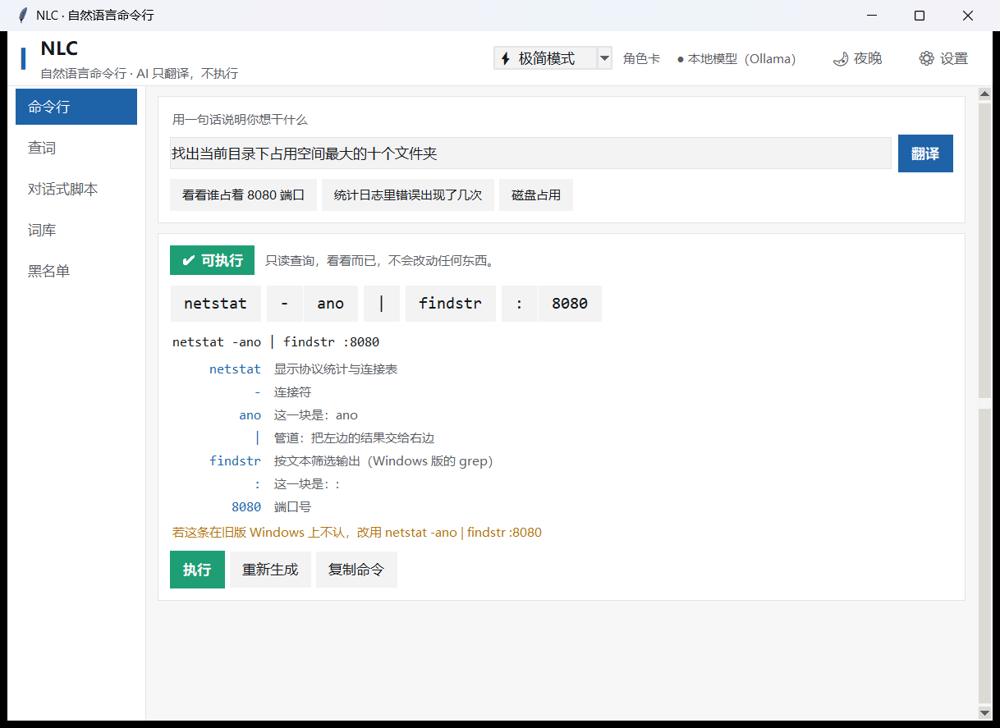
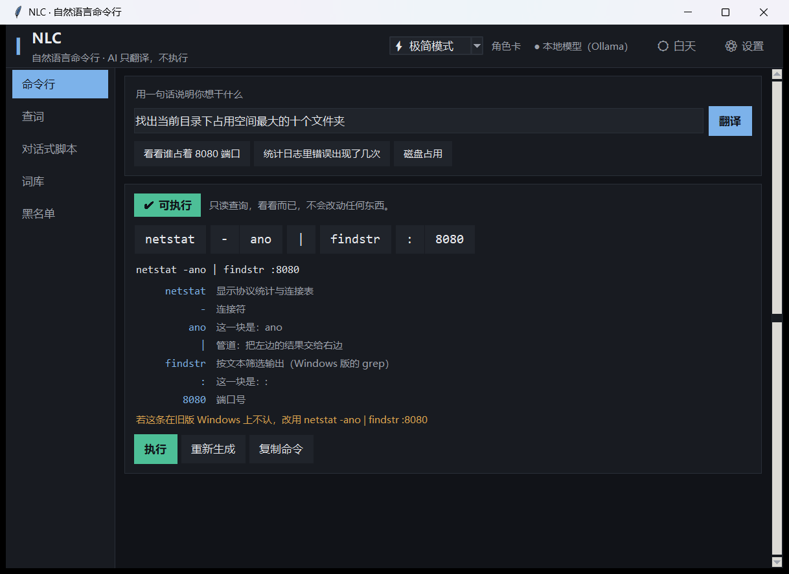
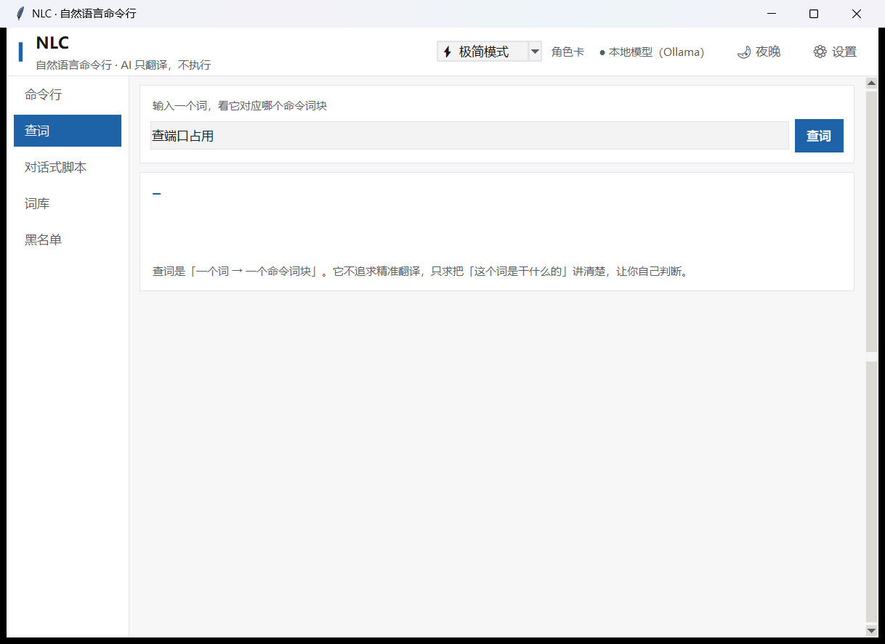
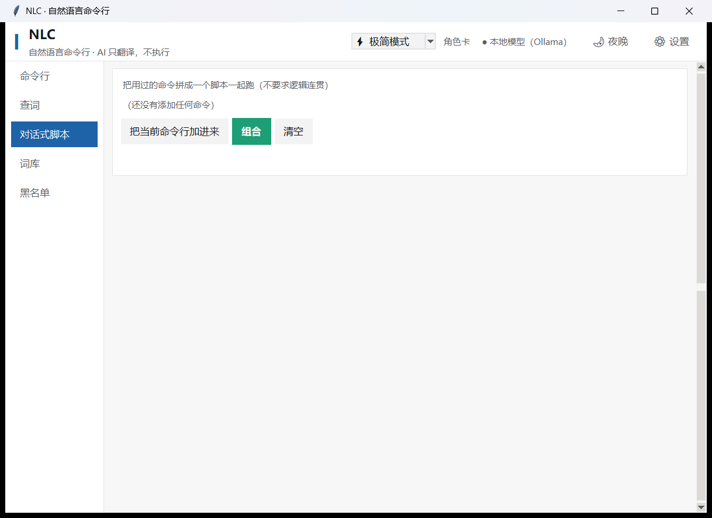
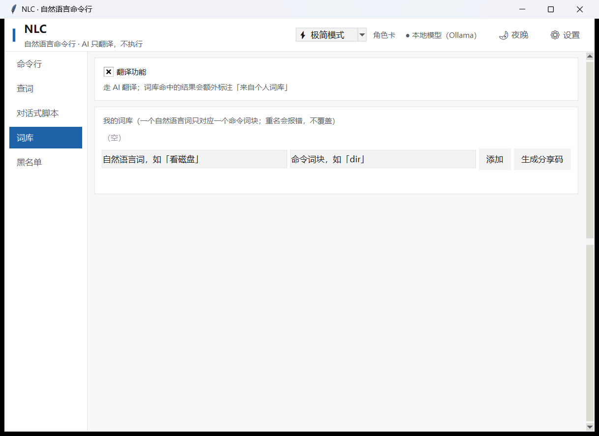

# NLC · 自然语言命令行

> **Natural Language Command-line** —— 在人与命令行之间加一层 AI 翻译。

```
你：「看看谁占着 8080 端口」

Windows / cmd        →  netstat -ano | findstr :8080
Windows / PowerShell →  Get-NetTCPConnection -LocalPort 8080
Linux                →  lsof -i :8080

      ↑ 每个词块都点了能看解释；不对的点掉，再点「重新生成」
```

**同一套代码，Windows 与 Linux 都能跑。零第三方依赖。**

| 日间 | 夜间 |
|---|---|
|  |  |

| 查词 | 对话式脚本 | 词库与黑名单 |
|---|---|---|
|  |  |  |

---

## 一句话定位

**NLC 的本质是在人与命令行之间加入了 AI 翻译层。它不执行任何东西 —— 决策权完全属于人。**

由此推出三条不可动摇的原则：

| # | 原则 | 落地 |
|---|---|---|
| 1 | **AI 只翻译，不执行** | 没有任何后台进程持有执行权；执行必须由用户按下按钮 |
| 2 | **AI 不决定，只建议** | 风险判定由**本地规则引擎**做，不是让大模型自己说"这个危险" |
| 3 | **解释优先于精准** | 不求"唯一正确答案"，只求**说清楚这条命令是干什么的** |

---

## 两种平台、两种命令行，都支持

| 平台 | 界面 | 风险规则 | 配置位置 |
|---|---|---|---|
| **Windows** | tkinter（Python 自带，双击即开） | cmd **+** PowerShell | `%APPDATA%\nlc` |
| **Linux** | tkinter（GTK3 版可用 `--gtk`） | bash | `~/.config/nlc` |

**风险规则两套一起跑、取最严** —— 不做"按平台切换"。
因为 Windows 上装了 Git Bash 的人 `rm -rf /` 一样敲得出来；反过来多拦一下也无害。
（安全工具该有的偏向：宁可多报，不可漏报。）

**命令行方言**由用户指定，因为它决定"生成哪种命令"：

```
nlc shell set cmd        # Windows 命令提示符（Windows 上的默认）
nlc shell set ps         # PowerShell
nlc shell set bash       # Linux shell
nlc shell set auto       # 跟随平台默认
```

---

## 三重架构

| 层 | 中文 | 命令 | 输入 | 输出 |
|---|---|---|---|---|
| ① | **查词** | `nlc lookup` | 一个词 | 命令词块 + 词义解释 |
| ② | **命令行** | `nlc tr` | 一句话 | 命令 + 整句解释 |
| ③ | **对话式脚本** | `nlc compose` | 从历史挑若干条 | 组合脚本 + 整体解释 |

### 术语（严格定义）

```
命令词块（Token）   = 一个英文单词，或一个符号
命令行（Command）   = 两个或两个以上的命令词块组成的最小可执行命令
对话式脚本（Script）= 两句或两句以上的命令行的组合
```

**切分规则**：连续的一段字母/数字/下划线算一个词块；**其余每一个字符各自单独算一个词块**；
重复出现的各自独立计数。

| 输入 | 词块数 | 结果 |
|---|---|---|
| `find` | 1 | `find` |
| `-name` | **2** | `-` `name` |
| `"*.log"` | **5** | `"` `*` `.` `log` `"` |

> ⇒ 因此**拉黑必须按位置（下标）**，不能按词的值 —— 否则点掉一个 `|` 会把两个管道一起废掉。

### 黑名单机制

翻译结果按词块切开显示，点掉不对的，再点「重新生成」：

- **保留**没点掉的 · **替换**点掉的
- **一个都不点** ⇒ 整条全部换掉
- 分**临时区**（按**下标**，本次查询有效）和**永久区**（按**词块文本**，跨会话）

---

## 风险三档

判定优先级 **禁止 > 需确认 > 放行**（借 Claude Code 的 `deny > ask > allow`）。

| 档位 | 按钮 | 行为 |
|---|---|---|
| 🟢 放行 | 绿 | 直接执行 |
| 🔴 需确认 | 红 | 弹危险确认框，说明危险在哪 |
| ⚫ 禁止 | 灰、点不动 | 关键路径删除等，**不提供执行入口** |

规则来源：对照 **OpenAI Codex** / **Claude Code** / **DeepSeek Harness** / **Gemini CLI**
在默认权限下的实际行为。其中「关键路径 `rm` 熔断」照搬 Claude Code。

### 两套规则各管什么

| | Linux（bash） | Windows（cmd / PowerShell） |
|---|---|---|
| 禁止 | `rm -rf /`、`mkfs`、`chmod -R 777 /`、`dd of=/dev/sda` | `format C:`、`diskpart`、`del /f /s /q C:\`、`Remove-Item -Recurse -Force C:\`、`vssadmin delete shadows`、`Set-MpPreference -DisableRealtimeMonitoring` |
| 需确认 | `rm`、`chmod`、`sudo`、`kill`、`reboot`、`apt install`、`curl \| sh` | `del`、`Remove-Item`、`taskkill`、`shutdown`、`reg`、`netsh`、`Set-ExecutionPolicy`、`cmd /c …`、`iex …` |
| 放行 | `ls`、`cat`、`du`、`grep`、`ps`、`ss`、`git status` | `dir`、`type`、`where`、`Get-Process`、`Test-Path`、`ipconfig`、`sc query` |

**包装器一律剥掉再判**：`env rm -rf /`、`sudo rm -rf /`、`cmd /c del /f /s /q C:\`、
`powershell -Command "Remove-Item -Recurse -Force C:\"`、`iex "…"` —— 全都按**被包住的命令**判定。

**完全访问模式**（对照 Codex `danger-full-access`）：默认关、不允许设为默认、
需手动输入确认短语「我明白风险」才能开。
⚠️ 但**「禁止」档仍然点不动** —— 这一档没有开关。

---

## 快速开始

### Windows

```
双击 nlc.cmd            ← 打开图形界面（不用安装、不用装任何东西）
双击 install.cmd        ← 可选：装到 %LOCALAPPDATA%\Programs\nlc + 建开始菜单项
双击 uninstall.cmd      ← 卸载（四道安全阀，只删清单里记着的东西）
```

命令行用法：

```bat
python -m nlc tokenize "del /f /s /q C:\Windows"    :: 切词块（不需要密钥）
python -m nlc risk "del /f /s /q C:\Windows"        :: 判风险（不需要密钥）
python -m nlc shell                                 :: 看/改判哪种命令行
python -m nlc set-key deepseek sk-xxxxxxxx          :: 填密钥
python -m nlc tr "看看谁占着 8080 端口"               :: 翻译
python -m nlc gui                                   :: 图形界面
python -m nlc mcp                                   :: MCP 服务端
```

### Linux

```bash
./nlc.sh                 # 图形界面
./nlc.sh tr "看磁盘占用"  # 直接翻译
sh packaging/dist/nlc-0.2.0.run  # 一键安装（安装包见 Release）
```

### 一条命令装到 PATH（可选）

```bash
pipx install git+https://github.com/Gong-Qin/nlc    # 之后任意目录敲 nlc
```

### 通用的三条

```bash
python -m nlc providers     # 看平台 / 路径 / 方言 / 所有 AI 通道
python -m nlc prompt list   # 看四张提示词角色卡
python -m nlc danger status # 看完全访问模式
```

**零依赖** —— 只用 Python 标准库（图形界面用 tkinter，也是标准库）。
不需要虚拟环境、不需要 pip、不需要联网就能装。

---

## 测试

**四条，全部零第三方依赖，直接跑，不用 pytest。合计 435 项。**

| 命令 | 项数 | 管什么 |
|---|---|---|
| `python tests/selftest.py` | **138** | ★ 核心基线 —— 必须一直全绿，这是"没改坏东西"的唯一证据 |
| `python tests/selftest_win.py` | **246** | Windows 侧：cmd / PowerShell 规则、关键路径、包装器、方言、提示词 |
| `python tests/mcp_stdio_test.py` | **22** | MCP 端到端（真的起子进程走管道） |
| `python tests/gui_smoke.py` | **29** | 界面冒烟（起窗、切页、换主题、渲染危险命令、关窗后销毁） |

> Windows 上四条全跑；Linux 上跑 138 + 22 两条（Windows 规则与原生界面只在 Windows 有意义）。
> `selftest_win` 里有 4 项检查的是**打出来的 zip 本身** —— 干净检出、还没打包时会跳过并计成
> **242 项**，先跑一次 `python packaging/build_package.py --windows` 才是完整的 246。
> 每次 push 由 [GitHub Actions](.github/workflows/test.yml) 在 `ubuntu-latest` + `windows-latest` 上自动验证（会先打包再测）。

> **为什么不用 pytest**：目标环境（别人的电脑）未必装得上，
> 而这个自测必须开箱即跑 —— 那正是「开源、可移植」要求的一部分。
>
> **为什么分四条**：分开才能一眼看出"是哪一侧坏了"。

---

## 提示词角色卡（可训练）

借鉴 AI Agent 里的「智能体 / 角色卡」：一张卡 = 一套完整的行为设定。

内置四张，实测效果（同一句话，命令完全相同，篇幅差 3.7 倍）：

| 角色卡 | 适合 |
|---|---|
| 🔧 老手模式 | 熟手，只看非显而易见的部分 |
| ⚡ 极简模式（默认） | 日常，零废话 |
| ⚖ 平衡模式 | 想要一点来龙去脉 |
| 🎓 讲解模式 | 完全的新手，多打比方 |

**「缩思维链、不废话」不是靠一句"请简洁"，是靠四层收紧：**

| 层 | 做法 |
|---|---|
| **措辞层** | 列出**明确的禁止项**：不要复述问题、不要展示思考过程、不要写结尾总结、不要客套 |
| **结构层** | **固定字段的 JSON 输出契约**，不给自由发挥留空间 |
| **长度层** | 每个字段**给出字数上限**（数值约束比形容词有效得多） |
| **参数层** | `temperature=0`、收紧 `max_tokens`、开启服务端 **JSON 模式** |

**最彻底的一步在代码里**：推理类模型会把思考过程放在 `reasoning_content` 字段、
正式回答放在 `content` 字段。**NLC 只取 `content`，直接丢弃 `reasoning_content`** ——
思考过程根本不会被带进界面。

**按平台换措辞**：模型会被告知"你要写的是 cmd / PowerShell / bash 命令"，
cmd 模式下还会明写"cmd 没有 `ls`/`rm`/`grep`，对应写法是 `dir`/`del`/`findstr`"。
不写这一段，模型会给出 Linux 命令，而用户在 Windows 上根本跑不了。

---

## 个人定制词库

严格一对一：一个自然语言词 → 一个命令词块。**重名直接报错，不覆盖**。

- **纯查表**：只做精确匹配（前后空格忽略），不做语义理解、不做模糊匹配
- **分享**：分享码（`NLC1-…`，zlib+base64）或 `.nlcwords` 文本文件
- **导入的词条一律标记「未经审核」**，第一次执行时强制确认
- **翻译开关**：开着时走 AI 翻译并额外标注「来自个人词库」；关掉后输入框变快捷方式、回车直跑

> ⚠️ **安全底线**：即使翻译关着、即使是自己填的词库，**危险命令仍然要过风险判定**。
> 「翻译开关」和「风险开关」是两件完全不同的事，不能互相绕过 —— 这条有专门的测试守着。

---

## MCP 服务端

```bash
python -m nlc mcp              # 作为 MCP 服务端跑（stdio 传输）
python -m nlc mcp --list-tools # 列出暴露的工具
python -m nlc mcp --selftest   # 不接客户端，自己跑一遍
```

### 暴露的 6 个工具（**全部只读，没有任何执行能力**）

| 工具 | 要密钥吗 | 用途 |
|---|---|---|
| **`nlc_assess_risk`** | ❌ **不要** | ★ 判一条命令是 allow / confirm / block。**任何 MCP 客户端都能免费拿来把关** |
| **`nlc_tokenize`** | ❌ 不要 | 切成命令词块 |
| `nlc_translate` | ✅ 要 | 自然语言 → 命令 + 逐词块解释 + 风险 |
| `nlc_explain` | ✅ 要 | 给现成命令做逐词块解释 |
| `nlc_wordbank` | ❌ 不要 | 查个人词库（纯查表） |
| `nlc_blacklist` | ❌ 不要 | 读永久黑名单（生成命令时应避开） |

> **四个工具不需要 API Key、不联网** —— 这是刻意设计的：
> 把"这条命令危不危险"做成一个免费的公共设施。

### 接进客户端

```jsonc
// Claude Desktop / Cursor
{
  "mcpServers": {
    "nlc": {
      "command": "python",
      "args": ["-m", "nlc.mcp_server"],
      "cwd": "C:\\path\\to\\nlc"
    }
  }
}
```

```toml
# OpenAI Codex：~/.codex/config.toml
[mcp_servers.nlc]
command = "python"
args = ["-m", "nlc.mcp_server"]
cwd = "C:\\path\\to\\nlc"
```

Server 会在 `instructions` 里告诉客户端：
**「在把任何命令交给用户执行之前，先调用 `nlc_assess_risk`」**。

---

## 设计上的几个关键决定

| 决定 | 为什么 |
|---|---|
| **风险判定绝不交给大模型** | 大模型会出错、会被提示注入。判定必须由本地规则引擎做，模型被绕过也不影响安全 |
| **两套风险规则都跑，不按平台切换** | Windows 上装了 Git Bash 的人 `rm -rf /` 一样能跑；多拦一下也不会错 |
| **词块由本地切分，解释按下标对齐** | 命令里常有两个 `\|`，按文本对齐会串位；按**下标**才能一一对上 |
| **「重新生成」必须校验** | 实测中模型会嘴上答应、实际把旧写法原样返回。不校验这个按钮就是摆设 |
| **校验按词块序列、不按子串** | 早期用子串匹配，结果 `10` 会命中 `'1,10p'` 里的 `10`，把一次成功的替换误判成失败 |
| **包装器要剥掉再判** | `env` / `sudo` / `cmd /c` / `iex` 会把后面的东西当命令跑，不剥就是绕过口子 |
| **安全清单里不放包装器** | 曾经把 `env` 放进只读清单，导致 `env rm -rf /` 被当成 `env` 放行 |
| **逐词块解释要分批索取** | 一条 77 个词块的 PowerShell 命令一次性索要解释会超出 token 上限，JSON 被截断 ⇒ 整条命令一个解释都没有 |
| **平台差异只许出现在两个文件里** | `nlc/platform.py` 与 `nlc/risk_win.py`。散着写会让加第三个平台变成满地找 |

---

## 已知边界（如实记录）

- 单个符号或单个短数字被拉黑时不参与校验 —— 拿它做"不得出现"的判据会大面积误报。
- `eval` / `sh -c "…"` / `iex "…"` 里的内容无法静态分析，一律按「需确认」处理。
- 别名、函数、变量间接引用不展开（不执行就不知道值），按「未知命令」处理 ⇒ 需确认。
- 未知命令默认「需确认」（与 Codex 的 `untrusted` 模式一致），不默认放行。
- Windows 侧的 `ForEach-Object` 靠"脚本块里出现了什么命令"来粗判 ——
  这是**启发式**，拿不准时给「需确认」而不是「放行」。
- `%APPDATA%\nlc\secrets.json` 的权限在 FAT32 盘或组策略受限的机器上收不紧，
  这时 `nlc set-key` 会**如实报告失败**，不假装成功。

---

## AI 接入

统一走 **OpenAI 兼容的 `/chat/completions`**，预置国内可直连的七家：
DeepSeek / 通义千问 / Kimi / 智谱 GLM / 硅基流动 / MiniMax / 阶跃星辰，
外加本地 Ollama、局域网模型、自定义。

**降级链**：云端 → 本地 → 局域网 → **离线知识库兜底（永不失败）**

密钥与主配置分离存放：`secrets.json`，
Linux 上走 `chmod 600`，Windows 上走 `icacls`（因为 `os.chmod` 改不了 NTFS 的 ACL）。

---

## 项目结构

```
nlc/
├── nlc/
│   ├── platform.py    ★ 平台适配层（配置目录 / 方言 / 权限 / Python 叫法）
│   ├── risk.py        三档风险引擎主流程（两套规则都跑，取最严）
│   ├── risk_win.py    ★ Windows 风险规则（cmd + PowerShell）
│   ├── tokenizer.py   命令词块切分 + 分段（认 cmd 的 ^ 与 PowerShell 的反引号）
│   ├── providers.py   AI 接入层（OpenAI 兼容，零依赖）
│   ├── prompts.py     提示词角色卡（按平台换措辞）
│   ├── translator.py  翻译层（查词 / 命令行 / 脚本 + 重新生成与校验）
│   ├── blacklist.py   词块黑名单（临时区按下标 / 永久区按文本）
│   ├── wordbank.py    个人定制词库
│   ├── mcp_server.py  MCP 服务端（stdio，6 个只读工具）
│   ├── gui.py         图形界面（tkinter，跨平台）
│   ├── gui_gtk3.py    Linux 上的 GTK3 界面（`nlc gui --gtk`）
│   ├── cli.py         命令行界面
│   └── __main__.py
├── packaging/
│   ├── install_windows.py / uninstall_windows.py   Windows 便携安装
│   ├── install.sh / uninstall.sh                   Linux 便携安装
│   ├── build_package.py                            打包
│   └── nlc.svg                                     图标
├── nlc.cmd            Windows 免安装启动器
├── install.cmd / uninstall.cmd
├── nlc.sh             Linux 免安装启动器
├── docs/screenshots/  真机截图（README 顶部引用的那几张）
├── .github/workflows/test.yml   CI：ubuntu + windows 双平台跑自测
├── pyproject.toml     `pipx install` 用（发行名 nlc-cmd，命令仍叫 nlc）
└── tests/
    ├── selftest.py        138 项核心自测
    ├── selftest_win.py    246 项 Windows 侧自测
    ├── mcp_stdio_test.py   22 项 MCP 端到端测试
    ├── gui_smoke.py        29 项界面冒烟测试
    ├── live_demo.py        需要 API Key 的实机演示
    └── profile_compare.py  四张角色卡的效果对比
```

### 分层

```
界面层（可选）：tkinter ｜ GTK3 ｜ CLI/TUI ｜ MCP 服务端
应用层        ：查词 ｜ 命令行 ｜ 对话式脚本 ｜ 个人词库
核心层        ：分词器 ｜ 风险引擎 ｜ 黑名单 ｜ 词库   ← 纯 Python，零依赖
接入层        ：云端 ｜ 本地 ｜ 局域网 ｜ 离线兜底
```

**核心层与界面层完全解耦**：核心必须能纯命令行用，GUI 只是锦上添花。

---

## 计划

- [x] 命令词块切分器 + 风险引擎 + **138 项**自测（Linux 侧基线）
- [x] AI 接入层（OpenAI 兼容，四通道 + 降级链）
- [x] 翻译层（查词 / 命令行 / 对话式脚本 + 重新生成与校验）
- [x] 提示词角色卡（四张内置卡 + 按平台换措辞）
- [x] 词块黑名单（临时区按下标 / 永久区按文本）、个人定制词库（含分享码）
- [x] 图形界面（tkinter 跨平台 + Linux 可选 GTK3）
- [x] MCP 服务端（6 个只读工具，四个不需要密钥）
- [x] 便携安装（Windows 与 Linux 各一套，均已走完安装→使用→卸载→零残留）
- [x] **Windows 支持**：平台适配层 + cmd/PowerShell 风险规则 + 原生界面（**246 项**新测试）
- [x] 打可分发的安装包（Windows `.zip` 与 Linux `.run`，见 Release `v0.2.0`）
- [ ] 提示词专项训练（要单开会话专门做）
- [ ] `nlc doctor`（一条命令做完整体检）
- [ ] 真正的执行后端（需要一次专门的安全评审）

---

## 许可

[MIT](LICENSE) © 2026 Gong-Qin

**为什么是 MIT**：这个项目的价值在"能被别人随手用起来"——零依赖、单文件可跑。
MIT 的约束最少，不吓退想把它塞进自己脚本里的人。若后续需要专利保护，再改 Apache-2.0。
